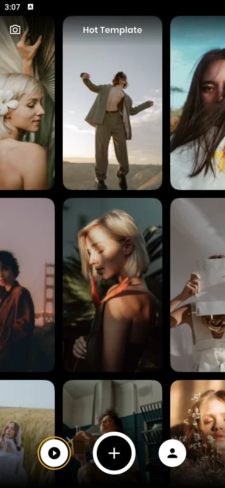
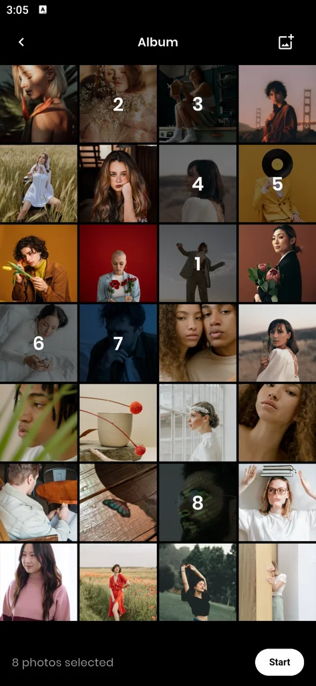
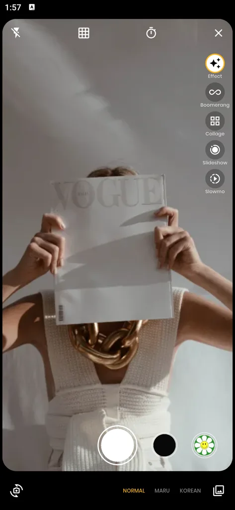
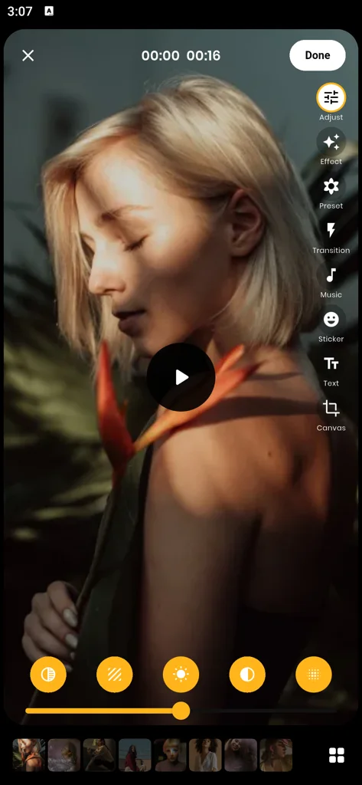
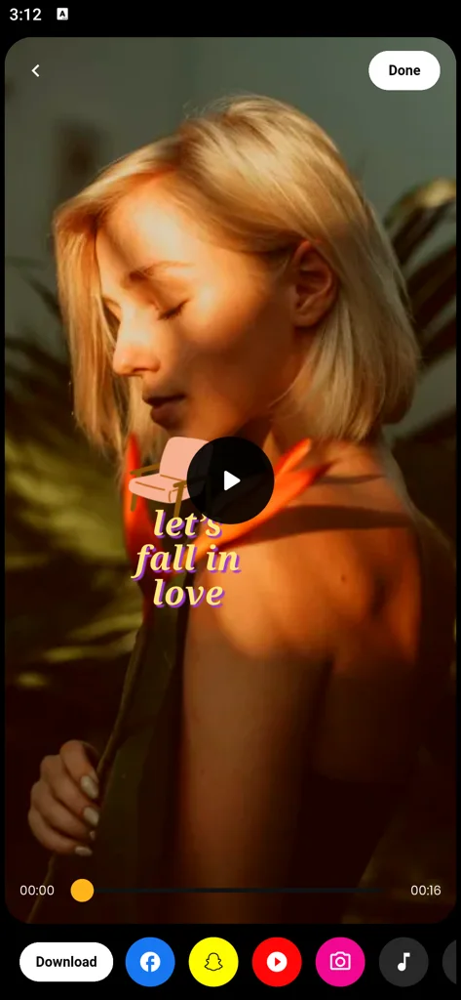

# Slideshow Photo Editor

基于 Pixso 同名设计稿开发的 Flutter Android 应用。通过 MCP 读取了 `Design`、`Style` 和 `Components` 三个页面，并按 `Design` 的 41 张画板实现模板、相册、相机、编辑和导出界面。相机和编辑器的同名画板通过界面的操作切换状态。

## 主要界面

<table>
  <tr>
    <th>热门模板</th><th>相册选片</th><th>相机</th><th>编辑器</th><th>导出</th>
  </tr>
  <tr>
    <td></td>
    <td></td>
    <td></td>
    <td></td>
    <td></td>
  </tr>
</table>

[查看全部界面截图和 Pixso 画板索引](docs/SCREENS.md)

## 运行

项目使用 Flutter 3.41.6、Android SDK 36 和 Gradle 8.14。当前机器可使用 FVM 中已安装的 SDK。在项目目录执行以下命令，设备 ID 可通过 `flutter devices` 查看。

```powershell
$flutter = "$env:USERPROFILE/fvm/versions/3.41.6/bin/flutter.bat"
& $flutter pub get
& $flutter run -d emulator-5554
& $flutter analyze
```

## 项目结构

```text
lib/
├── main.dart                应用入口、主题和首页
├── media.dart               项目模型、素材路径和本地存储接口
├── widgets.dart             预览容器、工具栏、时间轴、调节滑杆
├── slide_art.dart           预览、调色矩阵、转场和叠加内容
└── screens/
    ├── library.dart         模板、拼贴、项目、相册和模板预览
    ├── camera.dart          五种相机界面、构图与拍摄入口
    ├── editor.dart          八类编辑面板、时间轴与音乐库
    └── export.dart          导出预览、逐页光栅化和导出操作
android/app/src/main/
└── kotlin/…/
    ├── MainActivity.kt      设备选片、拍摄、存储与平台通道
    ├── VideoEncoder.kt      H.264、转场、音轨封装
    ├── AudioSamples.kt      生成离线演示音轨
    └── ExportProvider.kt    给系统分享面板提供临时读取权限
assets/media/                Pixso 照片、贴纸及效果缩略图
Poppins/                     本地字体
docs/screenshots/            Android 模拟器截图
```

## 页面与数据流

- 首页的加号进入相册、相机或拼贴。模板卡先进入模板详情，再进入选片和模板预览。项目页可打开本地项目及预置示例。
- 相册按选择顺序把照片传入编辑器。时间轴支持切换、排序和删除照片。编辑面板将照片、调色参数、转场、叠加内容、音乐和画布设置保存在 `Slideshow` 中。
- 点击编辑器的 **Done** 保存项目并进入导出页。项目保存为 Android 本地 JSON，用户导入的媒体保存在应用私有目录。
- 导出时 Flutter 将裁切、旋转、调色、文字和贴纸绘制成帧。Android 使用 `MediaCodec` 和 `MediaMuxer` 生成 24 fps 的 H.264 MP4，每张照片播放两秒。Android 10 及以上使用 `MediaStore` 存至 `Movies/Slideshow`。分享图标打开系统分享面板。
- Android 平台通道负责设备媒体访问、音乐预览和视频编码。项目没有第三方运行时依赖。导出结束后清理中间帧。

## 实现范围

- 相机画面使用 Pixso 样片展示五种模式。左下角可调起系统相机拍摄照片。Boomerang 和 Slowmo 是界面演示，实时取景、循环录像和慢动作录像尚未接入。
- 调色、滤镜强度、画布、文字与贴纸已接入编辑和导出。转场以淡入和横向推入为基础，部分素材与图标采用近似实现。
- 趋势音乐的界面曲名来自设计稿，试听使用应用生成的离线音轨。支持导入本地音频，MP4 导出可封装本地 AAC 音轨。Apple Music 尚未接入。
- 使用已有的 `emulator-5554`（Android 11、x86_64）验证。两张照片的样例导出为 4 秒 H.264 MP4，编辑后的八张照片样例导出为 16 秒 H.264 MP4，带 AAC 音轨。`ffprobe` 确认两段视频均为 360 × 640、24 fps。
